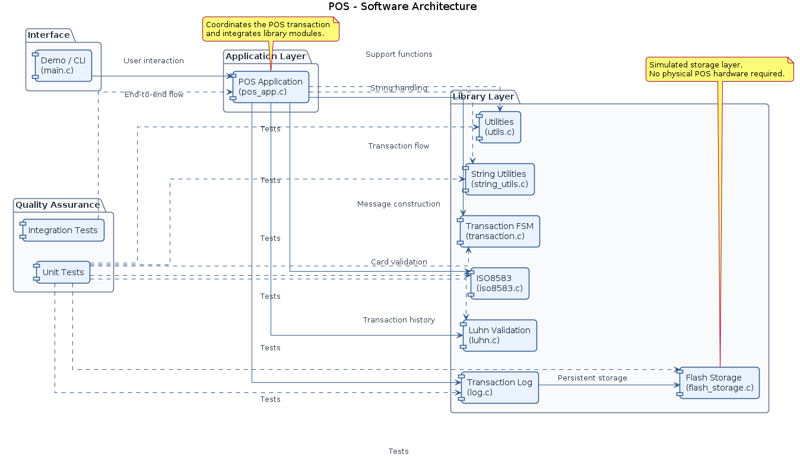
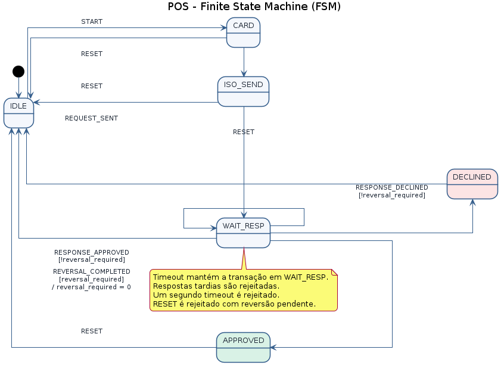

# POS Transaction Library

Biblioteca desenvolvida em C99 para simular funcionalidades essenciais de um terminal POS (Point of Sale), incluindo validação de cartões, construção e interpretação de mensagens ISO8583, gerenciamento do ciclo de vida de transações e armazenamento local de registros.

O projeto foi desenvolvido com foco em modularidade, segurança na manipulação de memória, tratamento de erros, testes automatizados e separação de responsabilidades.

## Objetivos

- Implementar funcionalidades básicas de processamento de transações POS.
- Construir e interpretar mensagens no padrão ISO8583.
- Validar números de cartão utilizando o algoritmo de Luhn.
- Gerenciar o ciclo de vida de uma transação por meio de uma máquina de estados finitos (FSM).
- Simular armazenamento persistente utilizando uma memória Flash.
- Registrar e recuperar o histórico de transações.
- Garantir a confiabilidade por meio de testes unitários e de integração.

## Tecnologias

- Linguagem C99.
- GCC.
- Make.
- Biblioteca padrão C.
- gcov para análise de cobertura.
- PlantUML para documentação da arquitetura e da máquina de estados.

## Arquitetura

O projeto está organizado em módulos independentes, com separação entre biblioteca, aplicação, demonstração e testes.



Diagrama editável: [docs/architecture.puml](docs/architecture.puml).

### Estrutura de diretórios

```text
.
├── app/
│   ├── inc/
│   └── src/
├── demo/
│   └── src/
├── docs/
│   ├── architecture.png
│   ├── architecture.puml
│   ├── fsm.png
│   └── fsm.puml
├── lib/
│   ├── inc/
│   └── src/
├── tests/
│   ├── integration/
│   ├── unit/
│   ├── test.h
│   ├── test_runner.c
│   ├── test_utils.c
│   └── test_utils.h
├── Makefile
└── README.md
```

### Responsabilidades

| Módulo | Responsabilidade |
|---|---|
| `iso8583` | Construção, serialização e interpretação de mensagens ISO8583. |
| `luhn` | Validação de números de cartão. |
| `transaction` | Gerenciamento dos estados e eventos da transação. |
| `flash_storage` | Simulação de armazenamento Flash. |
| `log` | Registro e recuperação de transações. |
| `string_utils` | Funções auxiliares para manipulação segura de strings. |
| `utils` | Conversão de valores inteiros para representação Big-Endian. |
| `pos_app` | Orquestração das funcionalidades da biblioteca. |

## Funcionalidades implementadas

### 1. Validação de cartão — Luhn

Implementação do algoritmo de Luhn para validar números de cartão.

São verificadas:

- Comprimento entre 13 e 19 dígitos.
- Presença exclusiva de caracteres numéricos.
- Dígito verificador conforme o algoritmo de Luhn.
- Limites de leitura para evitar acesso indevido à memória.

### 2. Mensagens ISO8583

Implementação de construção, serialização e parsing de mensagens ISO8583.

MTIs suportados:

- `0200` — Solicitação de transação.
- `0210` — Resposta de transação.

Campos suportados:

| Campo | Descrição | Formato |
|---|---|---|
| 2 | Primary Account Number (PAN) | LLVAR |
| 3 | Processing Code | Fixo |
| 4 | Amount, Transaction | Fixo |
| 7 | Transmission Date and Time | Fixo |
| 11 | System Trace Audit Number (STAN) | Fixo |
| 12 | Local Transaction Time | Fixo |
| 37 | Retrieval Reference Number | Fixo |
| 39 | Response Code | Fixo |
| 41 | Card Acceptor Terminal ID | Fixo |
| 49 | Currency Code | Fixo |
| 128 | Message Authentication Code (MAC) | Fixo |

O PAN é validado utilizando o algoritmo de Luhn.

O campo 4 utiliza 12 dígitos numéricos, conforme o formato definido para o campo de valor da mensagem.

**Regra de demonstração para o Response Code (campo 39):**

Para simplificar a simulação do processamento de uma transação, a aplicação considera:

- `00`: transação aprovada.
- Qualquer outro código: transação negada.

Essa regra existe exclusivamente para fins de demonstração. Em um ambiente real, a aprovação depende da resposta recebida do autorizador e da interpretação dos códigos de resposta conforme as regras do sistema de pagamentos.

O projeto não implementa comunicação real com adquirente, emissor ou rede de pagamentos.

### 3. Máquina de estados — FSM

Implementação de uma máquina de estados finitos para controlar o ciclo de vida de uma transação POS.

Estados implementados:

- `IDLE`
- `CARD`
- `ISO_SEND`
- `WAIT_RESP`
- `REVERSAL`
- `APPROVED`
- `DECLINED`

Eventos controlam as transições entre os estados.

Em caso de timeout durante a espera pela resposta, a transação passa para `REVERSAL` e sinaliza a necessidade de reversão por meio da flag `reversal_required`.

A conclusão da reversão é representada pelo evento `REVERSAL_COMPLETED`, que encerra o fluxo de reversão e retorna a FSM para `IDLE`.

A FSM controla o estado lógico da reversão, mas não implementa a comunicação de uma mensagem de reversão ISO8583.



Diagrama editável: [docs/fsm.puml](docs/fsm.puml).

### 4. Flash Storage

Implementação de uma memória Flash simulada em memória RAM.

Características:

- Capacidade total de 4096 bytes.
- Limite de 512 bytes por operação.
- Inicialização com todos os bytes em `0xFF`.
- Escrita respeitando a característica de uma memória Flash: somente transições de bits de `1` para `0`.
- Apagamento restaurando os bytes para `0xFF`.
- Validação dos limites de endereço e tamanho das operações.

### 5. Transaction Log

Implementação de um mecanismo de registro e recuperação de transações utilizando a memória Flash simulada.

Cada registro possui 34 bytes de dados e um cabeçalho de 2 bytes, totalizando 36 bytes armazenados.

Informações registradas:

- Timestamp.
- Identificador da transação.
- Valor da transação.
- Status.
- PAN mascarado.
- Código de resposta.

O PAN é armazenado mascarando os dígitos intermediários, preservando os seis primeiros e os quatro últimos dígitos.

Os dados serializados utilizam representação Big-Endian para os campos inteiros.

O mecanismo de XOR é utilizado como ofuscação simples dos dados, não como criptografia segura.

**Limite do valor registrado:**

O valor da transação é representado por `uint32_t`, em centavos. Portanto, o valor máximo suportado pelo registro é:

`R$ 42.949.672,95`

Embora o campo 4 do ISO8583 comporte até 12 dígitos, o armazenamento do Transaction Log possui essa limitação devido à utilização de um inteiro de 32 bits sem sinal.

## Instruções de compilação e execução

### Requisitos

Para compilação e execução em Linux:

- GCC.
- GNU Make.
- gcov para análise de cobertura.

Para compilação cruzada ARM:

- ARM GNU Toolchain (`arm-none-eabi-gcc` e `arm-none-eabi-ar`).

### Compilação para Linux x86_64

```bash
make linux
```

Gera a biblioteca estática:

```text
build/libpos.a
```

O target padrão também realiza a compilação para Linux:

```bash
make
```

### Compilação cruzada para ARM Cortex-M

O projeto possui configuração de cross-compilation utilizando a ARM GNU Toolchain.

O processador de destino padrão é Cortex-M4, utilizando instruções Thumb.

Para visualizar os comandos de compilação sem gerar binários:

```bash
make arm-sim
```

Para realizar a compilação cruzada:

```bash
make arm
```

A biblioteca estática será gerada em:

```text
build/arm/libpos.a
```

É possível selecionar outro processador Cortex-M por meio da variável `ARM_CPU`. Por exemplo:

```bash
make arm ARM_CPU=cortex-m3
```

A compilação ARM gera a biblioteca estática. A integração com o firmware final, incluindo startup code, linker script e dependências específicas do microcontrolador, deve ser realizada pelo projeto embarcado de destino.

**Observação:** `make arm-sim` apenas demonstra a configuração de compilação cruzada. Não gera código ARM nem substitui a compilação real com a toolchain instalada.

### Executar os testes

```bash
make test
```

Compila e executa os testes unitários e de integração.

### Executar a demonstração

```bash
make demo
```

Compila e executa a aplicação demonstrativa.

Também é possível executar diretamente:

```bash
./build/pos_demo
```

### Gerar cobertura de testes

```bash
make coverage
```

Executa os testes com instrumentação de cobertura e gera relatórios utilizando o gcov.

### Limpar arquivos gerados

```bash
make clean
```

Remove o diretório `build/`, incluindo os artefatos das duas plataformas.

## Testes automatizados

O projeto possui testes unitários e de integração, cobrindo os principais módulos da biblioteca e o fluxo de processamento da aplicação.

Os testes verificam:

- Validação de entradas e argumentos.
- Tratamento de ponteiros nulos.
- Limites de buffers.
- Construção e parsing de mensagens ISO8583.
- Validação de PAN.
- Transições válidas e inválidas da FSM.
- Escrita, leitura e apagamento da memória Flash.
- Registro e recuperação de transações.
- Fluxos de processamento da aplicação POS.

### Resultados dos testes

Última execução:

| Métrica | Resultado |
|---|---:|
| Total de testes | 681 |
| Aprovados | 681 |
| Falhos | 0 |
| Taxa de sucesso | 100,00% |

### Cobertura de código

Resultados obtidos com GCC/gcov.

#### Biblioteca (`lib/`)

| Arquivo | Cobertura de linhas | Branches executados | Branches percorridos ao menos uma vez |
|---|---:|---:|---:|
| `flash_storage.c` | 100,00% | 100,00% | 100,00% |
| `iso8583.c` | 92,31% | 100,00% | 85,21% |
| `log.c` | 90,00% | 100,00% | 75,71% |
| `luhn.c` | 95,83% | 100,00% | 95,00% |
| `string_utils.c` | 100,00% | 100,00% | 100,00% |
| `transaction.c` | 100,00% | 100,00% | 100,00% |
| `utils.c` | 100,00% | Não possui branches | Não aplicável |
| **Total da biblioteca** | **93,59%** | — | — |

A biblioteca apresenta **93,59% de cobertura de linhas**, com 100% de cobertura de branches executados nos módulos que possuem branches.

#### Aplicação (`app/`)

| Arquivo | Cobertura de linhas | Branches executados | Branches percorridos ao menos uma vez | Chamadas executadas |
|---|---:|---:|---:|---:|
| `pos_app.c` | 83,77% | 95,79% | 65,79% | 93,94% |

Os percentuais de branches seguem as métricas apresentadas pelo gcov.

A métrica `Taken at least once` indica a proporção de resultados possíveis dos branches que foram efetivamente percorridos ao menos uma vez.

A cobertura da aplicação é apresentada separadamente da cobertura da biblioteca, pois representam componentes distintos do projeto.

## Decisões técnicas

- **C99:** utilização de uma versão padronizada da linguagem C, adequada para sistemas embarcados e aplicações de baixo nível.
- **Biblioteca estática:** separação das funcionalidades em uma biblioteca reutilizável, independente da aplicação demonstrativa.
- **Modularização:** cada componente possui responsabilidade específica, facilitando manutenção e testes.
- **FSM:** utilização de uma máquina de estados explícita para controlar o fluxo da transação e evitar transições inválidas.
- **Big-Endian:** representação dos campos inteiros em formato Big-Endian para serialização dos registros.
- **Flash Storage:** simulação das restrições de escrita e apagamento de uma memória Flash.
- **Tratamento de erros:** utilização de códigos de retorno padronizados por meio de `POSStatus`.
- **Testes automatizados:** separação entre testes unitários e de integração.
- **Cobertura:** utilização do gcov para identificar trechos não exercitados pelos testes.

## Limitações e possíveis evoluções

Este projeto tem finalidade demonstrativa e não deve ser utilizado diretamente em um ambiente de produção financeira.

Possíveis evoluções:

- Comunicação real com adquirente ou host.
- Implementação de transporte seguro utilizando TLS.
- Integração com biblioteca de captura de dados de cartão.
- Implementação de reversão por meio de mensagens ISO8583.
- Implementação de mecanismos criptográficos seguros para proteção de dados.
- Persistência real em memória não volátil.
- Recuperação automática do histórico após reinicialização.
- Suporte a outros MTIs e campos ISO8583.
- Integração com mecanismos de autenticação e segurança de um terminal POS real.

## Conclusão

O projeto demonstra a implementação modular de componentes fundamentais de uma aplicação POS utilizando C99, com foco em gerenciamento de transações, manipulação de mensagens ISO8583, armazenamento local e testes automatizados.

Os resultados de testes e cobertura demonstram a preocupação com confiabilidade, qualidade de código e validação dos principais fluxos da aplicação.